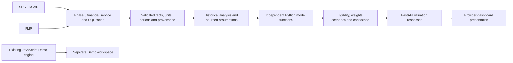

# Fairworth Phase 4: Python valuation engine

Verification date: 2026-10-14, Asia/Kuala_Lumpur. Engine version: `1.0.0`; API version: `0.4.0`.

Provider mode now uses Python for model eligibility, assumptions, all intrinsic-value calculations, weights, scenarios, comparisons, sensitivity, and reverse DCF. Demo mode preserves the existing JavaScript calculations and fictional data. Errors never substitute Demo calculations. The landing page, shared typography, footer, and core Demo formula files are unchanged.

## Architecture and contracts



`backend/app/valuation/inputs.py` builds canonical inputs from the normalized Phase 3 dataset and profile envelope. Reported amounts retain absolute reporting-currency units, share counts retain actual shares, and EPS retains currency/share. Invalid source units, dates, conflicting annual periods, nonfinite amounts, and untraceable derived values are excluded explicitly. Every financial fact retains its reported value, usable value, fiscal period, source observations, filing/accession information, signed derivation coefficients, and retrieval timestamp. A class-suffixed ticker with unknown classification or an explicitly unverified basis cannot reuse issuer-wide EPS or shares automatically. A verified share basis, explicit user confirmation, or an appropriate user-supplied per-share forecast retains its distinct source and applicability checks.

`history.py` analyzes aligned 3-, 5-, and 10-fiscal-year windows. Missing years, sign changes, nonpositive CAGR endpoints, fiscal transition periods, currency changes, duplicate periods, and unverified EPS/share-split bases cannot silently become growth forecasts. The four-company fixture contains six annual periods; longer requested windows correctly return insufficient history. Historical cash-dividend growth is a growth series of total reported dividends, not an invented adjusted dividend-per-share series.

`assumptions.py` separates reported inputs, historical estimates, derived forecasts, illustrative policy settings, and explicit user overrides. Suggested assumptions include source descriptions, periods, units, derivation methods, reset values, editability, override indicators, and warnings. Forward EPS/revenue/EBITDA are derived afresh when their growth assumptions change. They are not frozen trailing values. Share counts, cash, debt, and book equity can use validated annual baselines with explicit dates; these are not claimed to be current observations.

`models/` contains eleven independent valuation models and a separate reverse DCF diagnostic. `eligibility.py`, `weighting.py`, `scenarios.py`, `sensitivity.py`, and `confidence.py` orchestrate them. Models retain signed equity estimates. Nonfinite results and unrepresentable comparison ratios are unavailable rather than serialized as NaN/Infinity. Book-based methods require common-equity scope as well as meaningful book values; a bank label alone does not verify preferred/common claims.

`ValuationService` retrieves and deep-copies financial inputs, reuses an in-process snapshot for 60 seconds by default, and runs bounded calculations in a worker thread. Its cache retains at most 100 completed company snapshots. Stable data uses the existing persistent Phase 3 provider caches. Recalculation does not write assumptions, manual prices, or transient valuation snapshots to SQL. No database migration or dependency change is needed.

## Financial models and independent verification

All models below are implemented and have independent expected-value tests. Model test results are included in the passing backend suite. Enterprise models require debt, cash, preferred equity, minority interest, other nonoperating assets, and a compatible share denominator; absent claims are not assumed to be zero.

| Model | Mathematical specification | Required inputs and applicability | Limitations |
| --- | --- | --- | --- |
| FCFF DCF | FCFF = EBIT(1-tax) + D&A - capex - change in NWC. EV = discounted annual FCFF + discounted Gordon terminal value. Equity = EV - debt + cash - preferred - minority + other nonoperating assets. Divide by shares. | Complete components, explicit defensible FCFF, driver forecasts, or explicit annual projections; WACC > terminal growth; enterprise bridge and shares. | Standard industrial EV treatment is excluded for financial institutions. Ordinary OCF-capex is not substituted for FCFF. Tax benefits on losses require review. |
| FCFE DCF | FCFE = NI + D&A - capex - change in NWC + net borrowing. Discount at Ke and divide equity value by shares. | Compatible common-equity income and complete financing components, explicit FCFE, or explicit projections; Ke > terminal growth. | Missing net borrowing is unavailable. No second debt subtraction. Common-earnings scope cannot be inferred from mismatching consolidated NI/EPS. |
| Forward P/E | Forward EPS × target P/E. | Positive explicit forward EPS or a transparent forecast from comparable reported EPS; sourced/user target multiple. | Trailing EPS is not labeled forward. An explicit quoted-class per-share forecast can support ORCL without issuer-wide rescaling. |
| EV/EBITDA | Forecast EBITDA × target EV/EBITDA, followed by the enterprise bridge and share division. | Positive EBITDA forecast, complete bridge, shares, suitable operating business. | EBIT proxy + D&A is disclosed; unsupported company adjustments are not fabricated. Avoid industrial EV treatment for banks. |
| EV/Revenue | Forecast revenue × target EV/revenue, followed by the same enterprise bridge. | Positive revenue forecast, target multiple, complete bridge and shares. | Lower-confidence method; profitability and reinvestment are not explicitly priced. |
| PEG | Forward EPS × target PEG × earnings growth × 100. | Positive forward earnings and positive meaningful growth; explicit percentage-point convention. | P/E and PEG are correlated earnings evidence. Zero/negative growth is invalid. |
| Graham | sqrt(22.5 × positive EPS × positive common BVPS). | Meaningful common book equity, compatible EPS/shares, suitable business. | Historical screening heuristic, not a comprehensive value estimate. |
| DDM | Stable model: D0(1+g)/(Ke-g). Multi-stage: discounted explicit per-share dividends + discounted terminal dividend stream. | Sustainable dividend-policy confirmation, reliable per-share dividend inputs, Ke > growth. | Total SEC dividends/weighted shares are not fabricated into adjusted per-share dividends. Irregular/incomplete payout history needs analyst input. |
| Residual income | Initial common equity + PV(NI - Ke × beginning common equity) + PV(terminal residual income), divided by shares. | Meaningful common book equity, shares, ROE, payout, Ke, horizon, terminal assumptions, clean-surplus confirmation. | Forecast book equity follows earnings less dividends. OCI, buybacks and issuance are not silently invented. Terminal RI uses ending forecast book equity. |
| Price-to-book | Current or explicitly supplied common book equity/shares × justified target P/B. | Verified/confirmed common book scope, meaningful book values, shares and supportable multiple. | Suitability is financial, not universal. Preferred/noncontrolling amounts must not masquerade as common equity. |
| REIT AFFO | Reliable forecast AFFO/shares × target P/AFFO. | Confirmed appropriate REIT, reliable AFFO basis, shares and supportable multiple. | Neither NI nor ordinary FCF is AFFO. A user AFFO forecast is identified as an assumption. |
| Reverse DCF | Solve FCFF value minus comparison price = 0 for revenue growth or cash-flow growth. | Compatible comparison price, starting forecast framework, discount/terminal assumptions and bridge. | Diagnostic only; excluded from every weighted estimate. Explicit fixed projection arrays cannot imply a growth variable. |

Independent tests cover every model, exact bridges, no repeated FCFE debt adjustment, component tax calculations, incremental NWC, terminal discounting, signed cash flows, turnaround arrays, negative growth, missing inputs, invalid rates, nonpositive book equity, unit/currency mismatches, extreme multiples, nonfinite values, and numerical bounds.

### Differences from the JavaScript Demo engine

- Python accepts signed FCFF/FCFE projections and signed equity estimates rather than clipping them or requiring a positive starting cash flow. Invalid terminal spreads remain unavailable.
- Driver-based terminal cash flow is recomputed at terminal revenue growth, including its corresponding incremental NWC. It is not simply the last forecast cash flow multiplied by 1+g when reinvestment changes.
- Python derives FCFE only from complete financing-adjusted components or explicit analyst projections. Demo fictional cash-flow proxies are never used for Provider mode.
- Residual-income terminal RI uses ending forecast common equity and sustainable terminal ROE. In the independently tested example with initial book 1,000, ten shares, ROE 12%, payout 50%, Ke 10%, two years and zero terminal growth, Python returns $122.14214876/share; the preserved Demo convention returns $121.09090909/share.
- Reverse DCF scans 200 bounded segments and bisects crossing roots for up to 100 iterations, handling decreasing objectives, sampled multiple roots, flat/ambiguous objectives, and unbracketed solutions. Sampling does not guarantee discovery of every possible tangential or very closely spaced root; the solver returns its bounds, convergence, price residual, held assumptions, and limitations.

## Default assumptions, weighting and scenarios

Default hierarchy: explicit user input; validated history; verified sourced market-derived inputs; disclosed configurable policy; unavailable. Target multiples are not invented. A justified stable-growth P/E/P/B is conditional on reviewed book/clean-surplus assumptions; otherwise a user multiple is required. No fabricated beta, risk-free yield, debt cost, AFFO, claims, net borrowing or working-capital investment is supplied.

The initial illustrative policy uses a 10% cost-of-equity benchmark, 2% terminal growth, a five-year forecast, and growth fading toward terminal growth. These are Fairworth modeling settings, not observed market rates or company facts. The historical growth forecast range defaults to -15% through +20%; the original historical CAGR remains available separately, and unstable history can be unavailable. `backend/.env.example` documents configurable policy, cache and timeout settings. User overrides and resets remain separate from financial facts.

CAPM uses Ke = risk-free rate + beta × ERP. Rate records require an identified source and observation date; beta also requires an estimation method. WACC uses market-value capital structure and sourced debt cost. It does not silently replace market equity with book equity. A book-debt proxy requires an explicit opt-in and retains a warning. Supplied partial/invalid discount-rate evidence does not disable unrelated earnings models; the rate remains unavailable or a clearly labeled policy setting.

Default weights divide evidence into cash-flow, earnings, enterprise-multiple, book-equity, and distribution families, then account for suitability warnings. P/E and PEG share an earnings budget rather than counting as independent corroboration. User weights are preserved if a model becomes unavailable. Only enabled, valid outputs with positive weights enter the normalized calculation. Reverse DCF never enters it. A single-model estimate is explicitly identified.

Primary `assumptions` generate base and economically adjusted bear/bull defaults. Scenario-specific overrides rerun the underlying models independently and preserve explicit edits. Changes affect growth, margins, rates, reinvestment and multiples, not merely final fair-value percentages. Unusual ordering is reported rather than forcibly sorted.

Sensitivity runs the actual model and eligibility checks at each cell. Supported pairs include WACC/terminal growth, revenue growth/operating margin, Ke/terminal growth, forward EPS/P/E, forecast EBITDA/EV-EBITDA, and forecast revenue/EV-revenue. Automatic grids use fresh base assumptions or calculation details; explicit axes are bounded to eleven points each. Invalid cells are unavailable.

Confidence is a qualitative model-quality heuristic, not a statistical probability. Its breakdown covers missing inputs, independent model families, assumption quality, statement age, shares, model agreement, weight concentration and terminal exposure.

## API and frontend

| Method | Endpoint suffix under `/api/stocks/{ticker}` | Response |
| --- | --- | --- |
| GET | `/valuation/defaults` | Original defaults, all model eligibility, sources, scenarios and quality |
| POST | `/valuation/calculate` | Full authoritative result after edits |
| POST | `/valuation/scenarios` | Same full contract with independent scenario outputs |
| POST | `/valuation/sensitivity` | Validated sensitivity grid; a specification is required |
| GET | `/valuation/eligibility` | Structured suitability/reason/missing-input records |
| GET | `/valuation/explain` | Defaults, assumptions, facts, formulas/details and warnings |

Example calculation request (explicit illustrative analyst inputs, not defaults):

```json
{
  "assumptions": {"forward_eps": 10, "target_pe": 20},
  "scenario_overrides": {"bear": {"target_pe": 16}},
  "enabled_models": ["pe"],
  "weights": {"pe": 100},
  "manual_market_price": {"value": 180, "currency": "USD"},
  "sensitivity": {
    "model_id": "pe",
    "x_parameter": "forward_eps",
    "y_parameter": "target_pe"
  }
}
```

Requests reject unknown models/fields, invalid types, nonfinite numbers, invalid weights, unbounded arrays/grids, and arbitrary URLs/code. Forecast horizons are bounded to thirty years. Sensitivity matrices contain at most 121 cells. Calculation timeout defaults to eight seconds after input retrieval. POST CORS access uses the existing explicit origin allowlist. API keys and SEC identifying information remain server-side and are absent from results and maintained fixtures.

Provider React components send overrides, selections, weights, manual prices, and sensitivity requests to FastAPI. Recalculation is debounced by 300ms, aborts outdated requests, verifies response identity, and prevents slower earlier responses from replacing current results. Defaults/individual assumptions/models/weights can be reset. Invalid inputs or API failures expose clear errors and hide unavailable valuations. Advanced fields use absolute currency amounts and actual shares. Model calculation breakdowns display returned projections, bridge and terminal information.

The existing horizontal chart retains thick bars, value labels, gridlines, responsive layout and distance-based colors. Without a comparison price, bars use neutral colors and no market line is invented. A manual price is labeled **User-provided market price**, can be reset, and never replaces the official quote or its stored snapshot. Model comparisons, weighted comparisons, scenarios and sensitivity values are returned by Python; frontend distance coloring is presentation only.

## Verified companies

Real SEC/FMP-backed FastAPI and PostgreSQL checks succeeded for all four companies. The actual Provider dashboard was verified at 390px and 1440px for each company without route mocks, with no final browser runtime errors or page overflow. Scenario selection, sensitivity centers, missing quotes, manual-price use/removal and official-quote separation were checked.

**Untouched defaults return valuation unavailable for these four companies because supportable target multiples and/or critical inputs are absent.** This is deliberate. The following values are separate reproducible QA examples using an explicitly supplied forward EPS equal to 110% of latest reported diluted EPS, target P/E 20, and P/E as the sole weighted model. They are not default recommendations or independent multi-model confirmation.

| Company | QA forward EPS | Bear | Base/weighted | Bull | Provider comparison price | Base upside | Base margin of safety |
| --- | ---: | ---: | ---: | ---: | ---: | ---: | ---: |
| AAPL | $8.206 | $132.94 | $164.12 | $198.59 | $341.27 | -51.91% | -107.94% |
| MSFT | $19.745 | $319.87 | $394.90 | $477.83 | $543.45 | -27.33% | -37.62% |
| NVDA | $5.390 | $87.32 | $107.80 | $130.44 | $228.52 | -52.83% | -111.99% |
| ORCL | $6.413 | $103.89 | $128.26 | $155.19 | Unavailable | Unavailable | Unavailable |

Quotes are dated provider observations, not a real-time pricing claim. QA bear/bull estimates rerun EPS and target multiple adjustments. For ORCL, an explicitly supplied $150 comparison price enabled comparisons while keeping the same $128.26 intrinsic estimate and its official quote unavailable. The per-share forecast is a user assertion for the quoted class; its issuer-wide share and common-income scopes remain unverified in the financial facts.

| Company | Available under QA assumptions | Other models and missing inputs | Sources/quality |
| --- | --- | --- | --- |
| AAPL | Forward P/E | PEG needs a target PEG/meaningful growth; EV models need explicit preferred/minority/other-asset scope and target multiples; FCFF needs WACC and working capital or a complete explicit projection; FCFE needs financing-adjusted cash flow; book/DDM methods need scope/sustainability confirmations; AFFO is inappropriate for this non-REIT. | SEC facts and dated annual shares; actual FMP quote; historical forecast metadata or explicit QA forecast; low single-model quality. |
| MSFT | Forward P/E | Complete debt and mapped D&A remain absent; affected enterprise/DCF approaches stay unavailable. The other required multiples, claims, financing, common-book and dividend assumptions remain explicit. | SEC facts, FMP quote, user QA forward EPS/multiple. Missing debt is never zero. |
| NVDA | Forward P/E | Verified productive-asset capex/FCF are preserved, but are not FCFF/FCFE. Unstable or split-incomparable EPS history does not invent adjusted historical EPS. Missing enterprise claims, forecast/discount assumptions and multiples exclude other affected methods. | SEC concept/provenance retained; FMP current shares absent; explicit EPS forecast used independently of rejected automatic history. |
| ORCL | Forward P/E using explicit quoted-class EPS forecast | Quote/history/dividend endpoints remain FMP-subscription restricted; issuer share-class scope and consolidated NI/EPS mismatch remain unverified. Negative historical FCF is preserved. Enterprise, book, dividend and equity-cash-flow models require their actual missing inputs/confirmations. | SEC statements and FMP profile; no fabricated quote, common earnings, share conversion, net borrowing or claims. |

All four lack current FMP shares in the verified source data. The model contract distinguishes those missing observations from dated annual diluted weighted shares. Specialized AFFO and adjusted dividend-per-share data are not fabricated. Actual NI, source amounts and normalization formulas were not changed by Phase 4.

## Verification and reproducibility

| Check | Final result |
| --- | --- |
| Backend suite | 342 passed, including dedicated PostgreSQL migration/persistence/cache/downgrade integration and share-class regression coverage |
| Frontend unit suite | 36 passed |
| Browser regression suite | 58 passed, desktop/mobile Chromium |
| Actual Provider dashboard | Eight company/viewport combinations passed without API mocks |
| Actual four-company API | Defaults, independent scenarios, PE math, sensitivity centers, known missing inputs and manual ORCL price passed |
| ESLint / Vite production build | Passed |
| Alembic comparison / Python dependency check | Passed; no new schema migration or dependency change |

An upstream Starlette TestClient/httpx deprecation warning remains. An initial concurrent browser run hit Chromium `ERR_NO_BUFFER_SPACE`; its isolated case passed and the complete final two-worker run passed. No final checks are skipped when the dedicated PostgreSQL test database is configured. Without `TEST_DATABASE_URL`, that opt-in integration test remains explicitly skipped by design.

Run the existing setup instructions and install the existing lockfiles. Then:

```powershell
backend/.venv/Scripts/python.exe -m pytest backend/tests -q -p no:cacheprovider
npm run test:unit
npm run lint
npm run build
npm run test:e2e
backend/.venv/Scripts/python.exe -m alembic -c backend/alembic.ini check
```

For the optional PostgreSQL test, use the existing README instructions and a dedicated empty database ending in `_test`. Tests never target the application database. Deterministic verified financial excerpts and clearly identified synthetic mathematical examples run without financial API credentials. Transient verification JSON, screenshots, provider caches, real environment files, test outputs, dependencies and virtual environments remain ignored and local.

## Remaining limitations and phase boundary

- SEC input coverage remains the existing Phase 3 selected US GAAP/DEI USD mappings. Python contracts and models accept other explicitly compatible currencies, but production foreign-currency/IFRS/custom-concept ingestion and FX conversion require data adapters. No USD conversion is invented.
- Annual statements are the valuation baseline. Quarterly statements remain available; rolling TTM and inferred annualization are not introduced. Annual share/debt/cash values are dated modeling baselines.
- Missing debt, net borrowing, NWC, preferred/minority claims, reliable AFFO, adjusted per-share dividends and common-equity scope can prevent a model result. Explicit user forecasts remain assumptions, not verified facts.
- FMP entitlement prevents ORCL quotes/history/dividends under the current subscription. No subscription purchase or provider switch is made.
- No automatic live risk-free yield, beta estimator, debt yield, comparable-company multiple service or peer dataset is supplied. Sourced records and direct user assumptions are supported; benchmark policy is illustrative.
- Reverse-root sampling and clean-surplus/terminal forecasts have disclosed mathematical/economic limits. Confidence is heuristic. A useful number for every stock is not claimed.
- Physical mobile devices and Safari were not tested. Distributed ingestion/rate limiting, authentication, deployment hardening and other later-phase features remain separate work.
- No OpenAI integration, AI research, accounts, watchlists, payments, portfolios or Phase 5 features were implemented. Changes are not automatically committed or pushed.

## Methodology references

The distinction between [cash flow to the firm and equity cash flow](https://pages.stern.nyu.edu/~adamodar/New_Home_Page/littlebook/cashflows.htm), [stable growth and terminal-value constraints](https://pages.stern.nyu.edu/~adamodar/New_Home_Page/valquestions/stablegrowthrate.htm), and [discounted-cash-flow valuation principles](https://pages.stern.nyu.edu/~adamodar/New_Home_Page/background/valintro.htm) follows primary NYU valuation teaching materials. The illustrative numerical policy settings are Fairworth assumptions, not observations supplied by those sources.

## File inventory

Created implementation, tests, fixtures and documentation:

```text
backend/app/api/routes/valuation.py
backend/app/services/valuation_service.py
backend/app/valuation/__init__.py
backend/app/valuation/assumptions.py
backend/app/valuation/confidence.py
backend/app/valuation/eligibility.py
backend/app/valuation/engine.py
backend/app/valuation/history.py
backend/app/valuation/inputs.py
backend/app/valuation/models/__init__.py
backend/app/valuation/models/common.py
backend/app/valuation/models/ddm.py
backend/app/valuation/models/ev_ebitda.py
backend/app/valuation/models/ev_revenue.py
backend/app/valuation/models/fcfe_dcf.py
backend/app/valuation/models/fcff_dcf.py
backend/app/valuation/models/forward_pe.py
backend/app/valuation/models/graham.py
backend/app/valuation/models/peg.py
backend/app/valuation/models/price_to_book.py
backend/app/valuation/models/reit_affo.py
backend/app/valuation/models/residual_income.py
backend/app/valuation/models/reverse_dcf.py
backend/app/valuation/scenarios.py
backend/app/valuation/schemas.py
backend/app/valuation/sensitivity.py
backend/app/valuation/units.py
backend/app/valuation/validation.py
backend/app/valuation/weighting.py
backend/tests/fixtures/valuation/README.md
backend/tests/fixtures/valuation/verified_provider_excerpts.json
backend/tests/test_valuation_api.py
backend/tests/test_valuation_assumptions.py
backend/tests/test_valuation_engine.py
backend/tests/test_valuation_inputs_history.py
backend/tests/test_valuation_models.py
backend/tests/test_valuation_requests.py
backend/tests/test_valuation_units.py
docs/phase4-valuation-engine.md
src/components/dashboard/ProviderAssumptionEditor.jsx
src/components/dashboard/ProviderCalculationDetails.jsx
src/components/dashboard/ProviderSensitivity.jsx
src/components/dashboard/ProviderValuationStatus.jsx
src/hooks/useProviderValuation.js
src/lib/providerValuation.js
tests/helpers/providerValuationFixture.js
tests/provider-valuation.spec.js
tests/unit/providerValuation.test.js
```

Modified integration, configuration and regression files:

```text
README.md
backend/.env.example
backend/app/core/config.py
backend/app/main.py
backend/app/schemas/common.py
playwright.config.js
src/components/dashboard/AnalysisWorkspace.jsx
src/components/dashboard/ComparisonChart.jsx
src/components/dashboard/ModelComparison.jsx
src/components/dashboard/ReverseDCF.jsx
src/components/dashboard/ScenarioAnalysis.jsx
src/components/dashboard/SensitivityTable.jsx
src/components/dashboard/ValuationSummary.jsx
src/dashboard.css
src/lib/providerCompatibility.js
src/services/api.js
tests/provider-data.spec.js
tests/unit/providerCompatibility.test.js
```
