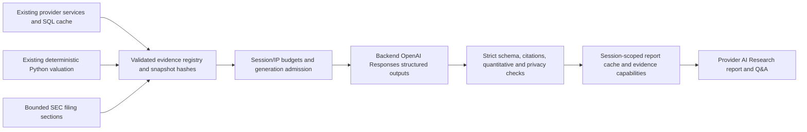

# Fairworth Phase 5: source-grounded AI equity research

Implementation date: 2026-10-15; citation-contract and presentation review: 2026-10-17, Asia/Kuala_Lumpur. API version: `0.5.0`. Existing deterministic valuation engine: `1.0.0`. Research prompt: `fairworth-research-9`. See [Phase 5.1 presentation and offline replay](phase5-1-presentation.md) for the latest changes and check results.

AI Research adds structured research reports and company-specific Q&A to Provider mode. The Python valuation engine remains the authority for all financial calculations. A missing weighted valuation does not prevent financial research. No AI-generated value replaces an unavailable valuation, unknown claim, restricted quote, or official provider fact.

## A. Architecture and changed files

The existing SEC/FMP/Treasury adapters, SQL financial caches, normalized financial facts, historical analysis, valuation service, classifications, scenario engine and transient assumption contracts are reused. No financial formula, model eligibility, database schema or migration was changed for research. Demo calculations and the landing page remain unchanged.



New backend modules are in `backend/app/ai/`: `evidence.py`, `context.py`, `filings.py`, `schemas.py`, `prompts.py`, `client.py`, `validation.py`, `safety.py`, `limits.py`, `middleware.py` and `report_service.py`. `backend/app/api/routes/research.py` adds the API. Existing app wiring, configuration, safe logging and Python dependency files are updated. New AI tests cover evidence, filings, service, API, real-company excerpts and adversarial cases.

Frontend additions are `AIResearchWorkspace.jsx`, `src/services/aiResearch.js` and `src/ai-research.css`, plus deterministic transport fixtures, unit tests and browser tests. Workspace/navigation integration retains the mounted valuation hook, and the existing API transport accepts the opaque session header. Vite ignores backend/documentation/test artifacts to prevent unrelated filesystem activity from reloading an edited browser workspace.

## B. OpenAI configuration and integration

The official Python SDK `openai==2.54.0` is pinned with its dependencies in `backend/requirements.lock.txt`. Its installed Responses interface was inspected. The adapter uses `AsyncOpenAI.responses.create` with a strict JSON schema generated from Pydantic, then checks completion/refusal status before parsing the JSON with Pydantic. This avoids SDK parse helpers attempting to validate truncated JSON before completion status can be inspected. Requests use a server-configured model, bounded output, explicit timeout, no retries, no tools and `store=False`. Standard tests mock OpenAI; an additional HTTP MockTransport test runs the actual SDK serialization and parsing path.

This follows the [official Structured Outputs documentation](https://developers.openai.com/api/docs/guides/structured-outputs?api-mode=responses) and [Responses Python reference](https://developers.openai.com/api/reference/python/resources/responses). Structured outputs enforce shape, not financial truth; independent evidence checks remain necessary.

Add placeholders from `backend/.env.example` to the private server configuration:

```dotenv
AI_RESEARCH_ENABLED=false
OPENAI_API_KEY=
OPENAI_MODEL=
OPENAI_REQUEST_TIMEOUT=45
OPENAI_MAX_OUTPUT_TOKENS=5000
AI_MAX_CONTEXT_TOKENS=64000
AI_REPORT_CACHE_TTL=1800
AI_MAX_CONCURRENT_REQUESTS=2
AI_CLIENT_REQUESTS_PER_MINUTE=6
AI_CLIENT_REQUESTS_PER_HOUR=20
AI_GLOBAL_GENERATIONS_PER_DAY=50
```

Select an account-authorized model that supports Responses structured outputs before enabling generation. No model ID is assumed, selected or upgraded automatically. These settings belong exclusively on FastAPI, never in `VITE_` variables. Missing configuration returns a safe disabled/configuration message without creating a paid request. Authentication, provider quota/rate limits, connection failures, timeout, refusal, incomplete/truncated responses and invalid structured output have explicit safe error paths; failures do not produce substitute research.

## C. Evidence registry and claim validation

Each deterministic evidence ID binds company, category, source, metric/value/unit, fiscal period, observation date, original URL/accession, derivation and warnings. Retrieval dates are preserved but do not make dated financial observations current. Only validated public provider URLs without credentials/query strings are exposed. No filing URL or excerpt is invented.

The assembler reuses validated canonical financial inputs and engine outputs, checking company and exact financial snapshot compatibility. It includes material financial scalars and historical metrics, market/manual-price status, bear/base/bull summaries, model eligibility/missing inputs/weights/classifications, effective assumption provenance, sensitivity, reverse DCF and confidence methodology. Grouped evidence retains complete context where appropriate. Context selection is bounded and explicitly discloses omissions; it does not truncate a scalar away from its unit or fiscal period.

Generated prose uses structured findings with titles, explanations, evidence IDs, categories, uncertainty labels and quantitative claims. The generation-only explanation is an ordered list of text and typed references, with per-kind ID enums selected from that request's binding catalog. Titles are qualitative only and generated quantitative-claim arrays must be empty. Prompt v8's generation `evidence_ids` selects additional qualitative sources; the backend derives complete per-finding citation coverage from those IDs and the finding's explicit, eligible typed parts. The SDK adapter freezes the exact serialized request scope before generation. Unknown/ineligible references, raw numerical prose and cross-finding citation borrowing remain invalid. See the [citation coverage repair](phase5-citation-coverage.md) for the exact retained v7 failure and its offline regression.

The backend converts these parts to complete internal bindings, validates them independently and renders the existing flat public API. Finite scalar values, dates, periods, model names and citation-only records are explicit; null values, structured aggregates and methodology text cannot become numerical bindings. The server constructs exact metric/value/unit/period/derivation claims, preserving integer precision. Literal numeric assertions in prose, including Unicode numerals, financial shorthand and common English quantities, still fail validation. Classification, citation, privacy and recommendation checks remain independent. Whole-record context selection includes the dynamic schema in its budget; essential eligibility evidence is protected and an insufficient budget fails before generation. See the earlier [typed binding repair](phase5-binding-validation.md) for v6 captured failures and formatting details.

In reports, the entire unsupported-prose finding is withheld and replaced by an explicit unavailable placeholder; the original text and numbers are never displayed. Valid findings can remain in a clearly flagged partial report. A report with no valid findings is rejected. Unknown citations, invalid bindings, mismatched quantities/categories and privacy failures still reject the report. Chat retains strict rejection behavior. No financial arithmetic is delegated to AI. The earlier [MSFT repair report](phase5-msft-research-fixes.md) documents the original numerical false-positive and source/UI investigation.

A correct ID and matching number **do not prove semantic support** for a complex qualitative statement. Every response displays this verification limitation and invites original-source review. Filing/profile observations can be labeled as documented source content; interpretations must carry analytical/limited uncertainty. The prompt forbids unsupported company events, competitive claims, undocumented risks and Buy/Sell/Hold recommendations. These controls reduce risk but are not a complete semantic entailment system or a guarantee against hallucination.

The [category-contract repair](phase5-category-validation.md) defines every supported category/uncertainty pair in a shared module, enforces it with nested strict-schema alternatives and Pydantic/runtime validators, and preserves a redacted fixture for the later live `interpretation` / `documented` failure. No live generation was made for that repair.

## D. SEC filing retrieval

`FilingResearchService` reuses the existing SEC client's identification, limiter, transport and SQL cache. It selects bounded recent original 10-K/10-Q primary-document metadata. CIK, accession, form, date and basename are validated before constructing an SEC archive request; the caller cannot supply a URL. Redirects, compression, unsupported content, excessive size and unsafe paths are rejected. Bodies are streamed under a byte cap before full buffering.

The standard-library HTML parser removes hidden content, scripts/styles and embedded forms, then extracts bounded business, risk factors, MD&A, liquidity and financial-note sections by actual headings. Excerpts retain actual accession, form, filing date, heading, retrieval time and source URL. Filing text is untrusted evidence and never changes instructions, permissions or valuation inputs. Complete retrieval is bounded to thirty seconds, with bounded document calls and retries. Stale cached passages retain their original dates and warnings.

Defaults are `AI_FILINGS_ENABLED=true`, `AI_FILING_MAX_BYTES=1500000`, `AI_FILING_EXCERPT_CHARS=2500`, `AI_FILING_MAX_DOCUMENTS=2`, and `AI_FILING_CACHE_TTL=86400`. Large SEC documents or unusual markup can legitimately yield missing coverage. Structured financial research still works and clearly identifies the missing qualitative coverage. This is section retrieval, not complete filing ingestion or unrestricted web research.

Actual permitted-source verification retained two AAPL quarterly passages (risk factors and MD&A) in its bounded context; its annual filing exceeded the configured size limit. MSFT, NVDA and ORCL primary filings exceeded that limit and yielded no retained passages. Their research contexts explicitly disclose missing qualitative coverage. The source-selection regression ensures retrieved passages are not silently displaced by repeated model details, and missing coverage warnings survive numerous older financial notices. No access restriction or size safeguard was bypassed.

## E. Report contract and examples

`ResearchReport` contains server-owned ticker/company, generation time, financial/valuation snapshot IDs and dates, structured sections, validated evidence references, quality warnings, cache status and a session-bound snapshot token. `ReportDraft` is restricted to the model-authored findings; it cannot choose company identity, source URLs, authoritative timestamps or snapshots.

The sections are executive summary, business overview, financial analysis, valuation analysis, risks, potential catalysts, bull case, bear case, valuation drivers and data limitations. The Sources section is built from registry entries, not model-written links. Checked revenue or fair-value amounts can appear inside analysis through server-resolved evidence bindings, alongside exact source quantities.

For example, an AAPL valuation finding can explain that an illustrative historical P/E benchmark drives the estimate and cite the exact registered forward-EPS, target-multiple and base-value records. An NVDA finding can describe the unsupported historical benchmark and cite model blockers without supplying a target value. These are contract examples, not claims that live OpenAI authored a verified report.

## F. Company-scoped Q&A

Chat takes a bounded question and recent user/assistant conversation plus an optional validated `ValuationRequest`. The server assembles fresh evidence; caller-supplied conversation is untrusted context, never financial authority. Only a bounded recent subset is forwarded, with older turns removed as needed to respect the full input budget. Chat is not persisted to SQL or provider-managed conversation state.

Hypothetical recalculation requests such as “What is AAPL worth if earnings growth is 12%?” are routed to an explicit instruction to use the assumptions editor. No model-generated replacement price is accepted, and chat does not change assumptions or database facts. Current explicit editor assumptions may be supplied for interpretation and remain identified as user assumptions. Switching research/valuation views preserves edits; changing ticker or explicit assumptions clears stale research and cancels earlier requests.

## G. Security, limits, cache and API

All OpenAI requests originate on FastAPI. No tools, arbitrary URL retrieval, SQL writes, model selection or code execution are exposed to the model. Prompts keep application instructions separate from untrusted evidence/questions/history. Application keys, identifying contact details and connection credentials are excluded/redacted, with additional output privacy checks. Logs suppress HTTP/SDK request details; safe errors do not return provider debug text or stack traces.

Generation is disabled by default. A browser session header and actual client IP form the transient ownership key; forwarded IP headers are ignored. Session and IP request budgets are checked atomically, rotating sessions cannot bypass the IP budget, live counters are bounded, concurrent requests fail fast and an application-wide rolling daily budget caps uncached generations. POST requests are limited to 32KiB before JSON parsing, with a finite upload deadline. Both complete serialized input (including schema/history) and output are bounded. The configured input token ceiling is enforced conservatively using UTF-8 bytes as a tokenizer upper bound, rather than an optimistic character estimate.

Reports are cached in bounded in-process memory by owner, company, financial/valuation request snapshots, complete selected evidence/coverage, prompt version, model and output configuration. New filing coverage, manual assumptions, weights, comparison prices or relevant financial data invalidate interpretation. One session's hypothetical report is never another session's default report. Evidence GET requests require the correct session and opaque snapshot token; guessed IDs or other tickers are rejected. Only cited permitted evidence is retained for these capabilities. Cache and evidence records expire; shutdown clears them.

These limits are **per process** and reset on restart. Deploy the configured AI service with one worker plus trusted ingress connection/IP limits and an OpenAI project spending budget. A multi-worker or multi-instance public deployment needs a shared limiter/cache before enabling AI; this phase does not implement distributed budgets or authentication. The browser session is a resource-isolation capability, not an account or identity proof. Standard HTTP infrastructure remains responsible for overall connection/DoS controls.

| Route | Contract |
| --- | --- |
| `GET /api/stocks/{ticker}/ai/status` | Safe enabled/configured/available state and coverage cautions; no generation |
| `POST /api/stocks/{ticker}/ai/report` | Validated optional valuation request and regeneration flag; bounded structured report |
| `POST /api/stocks/{ticker}/ai/chat` | Bounded company question/history and optional current valuation context |
| `GET /api/stocks/{ticker}/ai/evidence/{evidence_id}?snapshot_token=...` | Session-bound cited evidence only |

The existing `/api` contract is retained; AI schemas/routes appear in OpenAPI. The frontend sends `X-Fairworth-Session`, allowed by the existing configured CORS origins. No full account or payment system was added.

## H. Four-company verification

The checked-in Phase 4/4.5 deterministic SEC/FMP/Treasury excerpts are reused through the actual evidence assembler, automatic assumptions engine and Python valuation engine. OpenAI responses are mocked; SDK schema, context-size and financial claim checks remain active.

| Company | Preserved evidence and expected behavior |
| --- | --- |
| AAPL | Automatic base value remains $214.2302568301956 for the preserved snapshot; single-model, policy-based interpretation is explicit. |
| MSFT | Automatic base value remains $619.5604742486083 for the preserved snapshot; missing complete debt remains unavailable. |
| NVDA | Default weighted value remains unavailable; missing/unstable defensible historical target evidence is not replaced by AI. |
| ORCL | Default weighted value and authorized market quote remain unavailable; provider restrictions, share/earnings scope and missing inputs are retained. |

These are dated fixture observations, not current quotes or AI recommendations. All four run report/cache/chat/company-specific evidence assertions. Manual comparison/assumption cases are isolated. Full report input packages measured approximately 57.8–58.1KB under the 64KB conservative budget; chat packages also fit, with bounded history pruning.

An additional actual SEC/FMP/Treasury-backed run assembled research contexts for all four companies without mocking the financial providers. It preserved the same available/unavailable default values and ORCL's absent permitted quote. Final live context packages were 57.7–57.9KB including the report schema and instructions, with company-scoped source records and explicit filing coverage described above. This verifies financial-source assembly, not live AI-authored reports or answers.

**Live configuration follow-up:** the user subsequently saved an OpenAI key, explicitly selected `gpt-5-mini`, and enabled AI. The backend was restarted and its actual status endpoint reports configured/enabled/available. A preflight verified that the outgoing AAPL package contains only public provider evidence and default valuations, with no credentials, private user assumptions or chat. The model supports Responses and structured outputs according to the [official model documentation](https://developers.openai.com/api/docs/models/gpt-5-mini).

Two bounded live AAPL report requests were attempted, each capped at 5,000 output tokens with a 45-second provider timeout and no automatic retries. The first returned an invalid structured response after 36.95 seconds. The concise recheck returned structured output but was rejected by numerical-prose validation after 40.16 seconds. These establish live authentication/connectivity and a successful structured response on the recheck, **not a successfully validated end-to-end research report**. The original first failure cannot be conclusively attributed to truncation, but actual-SDK mocked regressions demonstrate and correct the premature parsing edge case.

After those attempts, safe partial-report handling was added: unsupported prose findings are discarded and visibly marked withheld, while independent numerical/citation/privacy checks remain intact. Its report behavior was verified with deterministic tests. A later, separately requested bounded MSFT chat used the new evidence bindings but failed a mixed-category guard; the category correction then passed mocked regressions without an additional paid request. See the [complete MSFT repair and live outcome](phase5-msft-research-fixes.md). A real browser check against the restarted backend confirms Provider mode shows AI ready and enables Generate; that check explicitly blocked all AI POST requests and incurred no generation. Actual provider token usage/cost was not measured. Complete successful report/chat/UI tests remain explicitly mocked. Generated responses and safe smoke-test summaries remain ignored local artifacts; no key is documented or committed.

## I. Verification results

Final checks passed as follows. Standard tests require no real provider or OpenAI credentials. Generated screenshots, traces, local caches, environment files and verification snapshots remain ignored and uncommitted.

| Check | Final result |
| --- | --- |
| Complete backend suite, including preserved valuation tests and dedicated PostgreSQL migration/persistence checks | 1,090 passed, no skips; zero real HTTP attempts |
| AI evidence/context / filings / actual-fixture mocked integration / report-service / API / adversarial tests (included above) | 32 / 32 / 7 / 37 / 8 / 24 passed; 101 classification, 100 numerical, 211 typed-binding/eligibility/budget and 44 citation-coverage regressions also pass |
| Frontend unit tests | 47 passed |
| Full production desktop/mobile browser regression | 102 passed, including derived quantity/source traceability |
| Targeted AI desktop/mobile regression after sticky-header heading alignment | 24 passed |
| ESLint and final production build | Passed |
| Alembic schema comparison / Python dependency check | No new upgrade operations / no broken requirements |
| Actual permitted financial-provider evidence assembly | AAPL, MSFT, NVDA and ORCL passed; no OpenAI calls |
| Desktop/mobile visual verification at 1440px / 390px | Readable 14px body, dark text/placeholder, no overflow, dialogs fit, no runtime errors |

The backend retains one existing upstream Starlette TestClient/httpx deprecation warning. Actual-fixture tests preserve prior financial expected values. Additional adversarial regressions cover Unicode numeric bypasses, numeric category laundering, source-aware cache invalidation, escaped private strings, session-rotation capacity exhaustion, slow/oversized uploads and omitted qualitative coverage. Standard test output contains no real provider credentials. A final source/index/build audit found no private credential material; the index remains empty and the Phase 4.5 parent commit is unchanged.

Run the existing `npm run test:unit`, `npm run lint`, `npm run build`, `npm run test:e2e` and Python `pytest backend/tests`. Browser tests build a fresh production bundle and use a dedicated strict preview on port 4173, with no existing-server reuse; they leave the user's development server alone and avoid HMR-induced page resets. The PostgreSQL integration requires `TEST_DATABASE_URL` pointing to a dedicated database whose name ends in `_test`; never direct destructive test setup at the application database. `alembic -c backend/alembic.ini check` verifies application schema consistency and `pip check` verifies the locked Python environment.

## J. Remaining limitations and phase boundary

Research is AI-generated interpretation, not audited research, a price prediction or an investment recommendation. Semantic claim validation is incomplete; conservative labels and visible limitations do not replace human source review. The system has no independent news, analyst consensus, comparable-company research, scheduled event calendar, comprehensive filing search or guaranteed extraction coverage. Context bounds may omit older evidence and are disclosed. SEC and licensed provider restrictions remain intact.

AI research is available only for Provider mode. Physical mobile devices and Safari require separate verification; browser tests use desktop/mobile Chromium. Existing Phase 4.5 financial limitations remain unchanged. No Phase 6, authentication, watchlists, payments, AI-driven financial calculations or automatic commit/push is implemented.

## File inventory

```text
README.md
backend/.env.example
backend/app/ai/__init__.py
backend/app/ai/bindings.py
backend/app/ai/classification.py
backend/app/ai/client.py
backend/app/ai/context.py
backend/app/ai/evidence.py
backend/app/ai/filings.py
backend/app/ai/limits.py
backend/app/ai/middleware.py
backend/app/ai/prompts.py
backend/app/ai/report_service.py
backend/app/ai/safety.py
backend/app/ai/schemas.py
backend/app/ai/validation.py
backend/app/api/routes/research.py
backend/app/core/config.py
backend/app/core/logging.py
backend/app/main.py
backend/requirements.lock.txt
backend/requirements.txt
backend/tests/fixtures/ai/msft_category_uncertainty_failure.json
backend/tests/fixtures/ai/msft_v6_binding_failure.json
backend/tests/fixtures/ai/msft_v7_citation_coverage_failure.json
backend/tests/fixtures/valuation/msft_shares_debt_excerpts.json
backend/tests/test_ai_api.py
backend/tests/ai_generation_helpers.py
backend/tests/test_ai_binding_budget.py
backend/tests/test_ai_binding_contract.py
backend/tests/test_ai_binding_eligibility.py
backend/tests/test_ai_classification.py
backend/tests/test_ai_citation_coverage.py
backend/tests/test_ai_evidence_context.py
backend/tests/test_ai_filings.py
backend/tests/test_ai_four_company.py
backend/tests/test_ai_numeric_audit.py
backend/tests/test_ai_research_service.py
backend/tests/test_ai_security_audit.py
backend/tests/test_msft_source_audit.py
docs/phase5-ai-research.md
docs/phase5-binding-validation.md
docs/phase5-citation-coverage.md
docs/phase5-category-validation.md
docs/phase5-msft-data-audit.md
docs/phase5-msft-research-fixes.md
playwright.config.js
src/ai-research.css
src/components/dashboard/AIResearchWorkspace.jsx
src/components/dashboard/AnalysisWorkspace.jsx
src/components/dashboard/CompanyHeader.jsx
src/components/dashboard/DashboardLayout.jsx
src/components/dashboard/DataQualityNotice.jsx
src/components/dashboard/ProviderValuationStatus.jsx
src/components/dashboard/ResearchInsights.jsx
src/components/dashboard/SourceNoticeGroups.jsx
src/dashboard.css
src/hooks/useProviderValuation.js
src/lib/providerValuation.js
src/lib/sourceNotices.js
src/services/aiResearch.js
src/services/api.js
tests/ai-research.spec.js
tests/helpers/aiResearchFixture.js
tests/provider-data.spec.js
tests/unit/aiResearch.test.js
tests/unit/providerValuation.test.js
tests/unit/sourceNotices.test.js
vite.config.js
```
